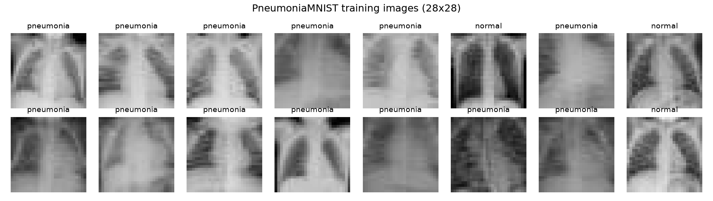
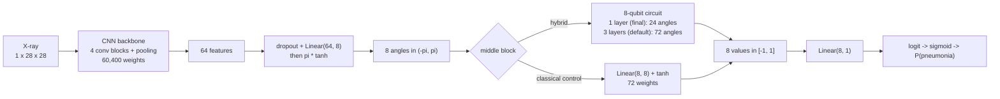
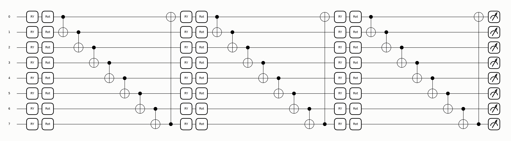

# How this project works, from zero

This walkthrough assumes you have never used PyTorch or a quantum computing library. Read it top to
bottom once; afterwards each section works as a reference for one part of the code.

## 1. The task

Each input is a 28 x 28 greyscale chest X-ray of a child: 784 numbers between 0 (black) and 255 (white).
The model outputs one number, the probability that the X-ray shows pneumonia. Above 0.5 we say
"pneumonia", otherwise "normal". The dataset (PneumoniaMNIST) comes in three fixed parts:

| Split | Used for | Images |
|---|---|---|
| train | learning the weights | 4,708 |
| validation | choosing settings and the best epoch | 524 |
| test | the final, one-time exam | 624 |

The test images are never used to make any choice. If they were, the test score would no longer measure
how the model does on unseen patients. That is why only one script (`evaluate.py`) is allowed to open them.

One quirk: the test split comes from a separate collection with a different class balance (62.5%
pneumonia, against 74% in train and validation). Scores on test are therefore lower than on validation.
That is a property of the data, not a bug.

## 2. PyTorch in one page

- A **tensor** is an n-dimensional array of numbers (like a NumPy array) that remembers how it was computed.
- A **model** (`nn.Module`) is a function with adjustable numbers inside, its **weights** or
  **parameters**. `model(x)` runs the **forward pass**: images in, predictions out.
- A **loss** measures how wrong the predictions are. We use binary cross-entropy: small when the model
  gives high probability to the correct class.
- `loss.backward()` computes, for every weight, the **gradient**: how much the loss would change if that
  weight changed a little. This is automatic differentiation; PyTorch records every operation in the
  forward pass and replays it backwards.
- An **optimizer** (`AdamW`) nudges every weight a small step against its gradient, which lowers the loss.
  The step size is the **learning rate**.
- Training repeats this on **batches** of 64 images. One pass over all training images is an **epoch**;
  we train for 30.
- `model.train()` and `model.eval()` switch layers such as dropout and batch normalisation between their
  training and prediction behaviour. Every prediction in this project runs in `eval()` mode under
  `torch.no_grad()`.

## 3. The whole model

The **backbone** is a small convolutional neural network (CNN). A convolution slides 3 x 3 filters over the
image to detect edges and textures; stacking four of them, with pooling that halves the image size,
builds up from edges to larger shapes. The backbone ends by averaging each of its 64 feature maps into a
single number, so any image becomes 64 features.

A linear layer then squeezes those 64 features into 8, and `pi * tanh` maps each into the range (-pi, pi)
so it can serve as a rotation angle. The **middle block** turns 8 numbers into 8 numbers. In the hybrid
model it is a quantum circuit; in the classical control it is an ordinary `Linear(8, 8)` layer with `tanh`.
Everything else is identical, which is what makes the comparison fair. The default 3-layer circuit has 72
trainable numbers, exactly like the control; the sweep (Section 10) found that 1 layer (24 numbers) works
just as well, so the final hybrid uses 1 layer and the 3-layer version is kept as a size-matched check.
A final linear layer turns the 8 outputs into one score (the logit), and the sigmoid function turns that
into a probability.

## 4. Quantum computing, only what this project needs

**A qubit** is the quantum version of a bit. Its state is a combination of the two basic states |0> and
|1>. You can picture it as a point on a sphere (the Bloch sphere): |0> at the north pole, |1> at the south
pole, and every other point a mix of the two.

**Measuring** a qubit gives 0 or 1 at random. A point near the north pole gives 0 most of the time. The
**expectation value** `<Z>` = P(0) - P(1) summarises this as one number: +1 at the north pole, -1 at the
south pole, 0 on the equator. Our circuit reports `<Z>` for each of its 8 qubits. A simulator can compute
`<Z>` exactly; a real device would have to estimate it by measuring many times ("shots").

**Rotation gates** turn the point on the sphere.
- `RY(theta)` rotates about the y-axis. Starting from |0>, `RY(theta)` gives `<Z> = cos(theta)`, so the
  angle directly controls the output.
- `RZ(phi)` rotates about the z-axis. On its own it does not change `<Z>`, but it changes how later
  rotations act.
- `Rot(phi, theta, omega)` = `RZ(omega) RY(theta) RZ(phi)` can reach any orientation. Its three angles
  are what training adjusts.

**CNOT** acts on two qubits: it flips the second (target) if the first (control) is |1>. Applied to qubits
in superposition, it creates **entanglement**: the qubits can no longer be described one at a time, and
measuring one tells you something about the other. Without CNOTs, qubit i's output could only ever depend
on input i.

**Eight qubits** have 2^8 = 256 basic states (|00000000> to |11111111>), and the simulator stores one
complex number (an amplitude) for each. Every gate is a small matrix multiplication on that list of 256
numbers. This is why simulating a few qubits is cheap, and why each extra qubit doubles the cost.

## 5. The circuit, step by step

Read the drawing left to right; each horizontal line is one qubit. One layer is:

1. **Encode (`RY` boxes).** Qubit i is rotated by `RY(x_i)`, where `x_i` is the i-th of the 8 angles from
   the CNN. This is **angle encoding**: an image feature becomes a rotation.
2. **Trainable rotations (`Rot` boxes).** Each qubit gets a `Rot(phi, theta, omega)` with its own three
   trainable angles: 8 qubits x 3 angles = 24 per layer.
3. **Entangle (the CNOT ring).** CNOTs from qubit 0 to 1, 1 to 2, ..., 7 back to 0.

In the default circuit the layer repeats 3 times, so 3 x 24 = 72 trainable angles. Repeating the encoding
before every layer is called **data re-uploading**: each input then enters the circuit several times, which
lets the circuit form more complicated functions of the inputs (in the same way that a polynomial of higher
degree can fit more shapes). At the end, `<Z>` of each qubit is read out, giving 8 numbers in [-1, 1].

The **final model uses a single layer**, drawn here:

With one layer the circuit is simple enough to write down exactly, which is a good way to see what it does.
On its own, qubit i ends up with `<Z> = cos(theta_i) cos(x_i) - sin(theta_i) cos(phi_i) sin(x_i)`, which is
just a shifted cosine of its input, `r cos(x_i + delta)`: a wavy "activation function" with two learned
numbers. The CNOT ring then multiplies these together: output k becomes the product of the first k+1
cosines. So the final hybrid's middle block is "8 learned cosine curves, then running products". A test
(`test_one_layer_circuit_has_closed_form`) checks this formula against the simulator.

In code (`src/quantum.py`), PennyLane's `qml.AngleEmbedding` does step 1 and
`qml.StronglyEntanglingLayers` does steps 2 and 3. `qml.qnn.TorchLayer` wraps the circuit so that PyTorch
treats it like any other layer: its 72 angles become an ordinary trainable parameter.

**Batching.** The simulator runs all 64 images of a batch at once ("parameter broadcasting"). It only works
because the code passes the whole `inputs` array to the templates; writing `inputs[i]` would pick image i
instead of feature i and silently break the model. One of the tests checks for exactly this.

**One detail worth knowing.** The last trainable gate on every qubit is the final `RZ(omega)` of the last
layer. After it come only CNOTs and the Z measurement, and RZ cannot change a Z measurement. So those 8
angles have no effect at all: their gradient is zero. The 3-layer circuit therefore has 64 working parameters
out of 72 (the final 1-layer circuit: 16 out of 24). We kept the circuit as specified and report this openly;
it slightly favours the classical control, whose 72 weights all work.

## 6. How gradients flow through a simulated circuit

The simulator (`default.qubit`) computes the 256 amplitudes with ordinary PyTorch tensor operations:
each gate is a matrix product, and `<Z>` is a weighted sum of squared amplitudes. Because it is all
PyTorch, `loss.backward()` differentiates straight through the circuit, exactly as through a convolution
(`diff_method="backprop"`). So one backward pass gives gradients for the CNN weights and the 72 circuit
angles together.

A real quantum computer cannot be differentiated like this, because its state cannot be read out. There,
gradients are estimated with the **parameter-shift rule**: run the circuit with an angle shifted by
+pi/2 and -pi/2 and take half the difference. It gives the same gradient, at the cost of two extra circuit
runs per angle.

**Barren plateaus.** If the 72 angles start at random values between 0 and 2pi, the circuit begins as a
random-looking operation and nearly all gradients are tiny, so training stalls. We start the angles small
(normal distribution, standard deviation 0.1), close to "do nothing", where gradients are healthy.
`train.py` logs the gradient size of the circuit angles every epoch to confirm it never collapses.

## 7. Training recipe

| Setting | Value | Why |
|---|---|---|
| Loss | binary cross-entropy with `pos_weight` = normal / pneumonia count | 74% of training images are pneumonia; this makes both classes count equally |
| Optimizer | AdamW; CNN lr 1e-3 with weight decay 1e-4; circuit lr 1e-2, no decay | angles need bigger steps; decaying a periodic angle towards 0 means nothing |
| Schedule | OneCycle: warm up for 15% of steps, then decay | stable start, fine settling at the end |
| Gradient clipping | norm 1.0 | avoids rare huge steps |
| Augmentation | small random rotation, shift and zoom; **no flips** | a mirrored chest puts the heart on the wrong side |
| Epochs | 30, keep the epoch with the best validation AUC | fixed before any result was seen |
| Seeds | 5 per final model | one run's test accuracy moves by a few points from randomness alone |

## 8. How the result is judged

- **AUC** (area under the ROC curve): the probability that a random pneumonia image gets a higher score than
  a random normal one. 1.0 is perfect, 0.5 is guessing. It ignores the threshold.
- **ACC** (accuracy) at threshold 0.5: share of images classified correctly.
- **Sensitivity**: share of pneumonia cases caught. **Specificity**: share of normal cases correctly cleared.
  In screening, a missed pneumonia (low sensitivity) is usually worse than a false alarm.
- **Seeds**: each model is trained 5 times with different random starts; we report mean and standard deviation.
- **Ensemble**: averaging the 5 seeds' probabilities usually gives a slightly better, steadier model.
- **Bootstrap confidence interval**: resample the 624 test images with replacement 2,000 times and recompute
  the score; the middle 95% of those values shows how much the score depends on which patients happened to
  be in the test set.
- **Decision rule** (fixed in advance): if the hybrid and classical means differ by less than the seed
  standard deviation, or their confidence intervals overlap, we report "no significant difference".

## 9. What each file does

| File | Job |
|---|---|
| `src/config.py` | Every setting in one dataclass; each becomes a command-line flag. Also the frozen final setting. |
| `src/data.py` | Downloads the data, checks the class counts, defines transforms and loaders, draws the data figures. |
| `src/quantum.py` | Builds the circuit (and its noisy and shot-based variants) and wraps it as a PyTorch layer. |
| `src/models.py` | The CNN backbone, the hybrid / classical model, and the quanvolution model. |
| `src/engine.py` | One training epoch, prediction, all metrics, bootstrap intervals. |
| `src/train.py` | Trains one setting with one seed and saves everything to `runs/<name>/seed<k>/`. |
| `src/sweep.py` | Runs many trainings (in parallel), skipping finished ones. |
| `src/evaluate.py` | The only reader of the test set: scores checkpoints, builds tables and figures. |
| `src/figures.py` | The plotting functions. |
| `src/predict.py` | Classifies a single image file. |
| `tests/test_smoke.py` | Quick checks that catch the classic silent failures. |

## 10. The experiments and what they showed

**Sweep (validation data only).** How many qubits (4 or 8) and layers (1, 3 or 5) does the circuit need?
Plus two on/off switches at 8 qubits x 3 layers: **entanglement off** (no CNOTs: tests whether qubits
need to interact) and **re-uploading off** (encode only once: tests whether repeated encoding helps).

<!-- results:sweep -->
| Setting | Seeds | Circuit params | Val AUC | Val loss | Val ACC | Mean best epoch | Epoch time (s) |
|---|---|---|---|---|---|---|---|
| 4q x 1L | 3 | 12 | 0.9943 ± 0.0016 | 0.0679 ± 0.0122 | 0.956 | 26.0 | 45.4 |
| 4q x 3L | 3 | 36 | 0.9955 ± 0.0010 | 0.0547 ± 0.0019 | 0.962 | 21.0 | 48.1 |
| 4q x 5L | 3 | 60 | 0.9956 ± 0.0002 | 0.0556 ± 0.0061 | 0.965 | 23.0 | 41.0 |
| 8q x 1L | 3 | 24 | 0.9957 ± 0.0006 | 0.0559 ± 0.0087 | 0.964 | 19.3 | 20.7 |
| 8q x 3L | 3 | 72 | 0.9958 ± 0.0010 | 0.0553 ± 0.0035 | 0.971 | 20.7 | 23.5 |
| 8q x 5L | 3 | 120 | 0.9954 ± 0.0010 | 0.0545 ± 0.0021 | 0.961 | 19.3 | 34.9 |
| 8q x 3L, no entanglement | 3 | 72 | 0.9957 ± 0.0007 | 0.0470 ± 0.0022 | 0.964 | 22.0 | 26.3 |
| 8q x 3L, no re-uploading | 3 | 72 | 0.9959 ± 0.0009 | 0.0535 ± 0.0057 | 0.961 | 20.3 | 16.6 |

Validation split only (524 images); mean ± sample std over seeds 0-2. Checkpoint = epoch with the best validation AUC. Epoch times measured with up to 8 runs sharing the CPU.
<!-- /results:sweep -->

**Final comparison (test data, once).** The chosen hybrid against the classical control and against the
same circuit without entanglement, 5 seeds each.

<!-- results:compare -->
**A = Hybrid 8q x 1L, B = Classical control (8 units)**

| Metric | Mean A − B | Larger seed std | Ensemble 95% CI, A vs B | CIs overlap | Seeds where A > B | Verdict |
|---|---|---|---|---|---|---|
| AUC | -0.0031 | 0.0036 | [0.967, 0.989] vs [0.971, 0.989] | yes | 0 of 5 | **no significant difference** |
| ACC | -0.0151 | 0.0282 | [0.904, 0.946] vs [0.921, 0.958] | yes | 1 of 5 | **no significant difference** |

**A = Hybrid 8q x 1L, B = Hybrid 8q x 1L, no entanglement**

| Metric | Mean A − B | Larger seed std | Ensemble 95% CI, A vs B | CIs overlap | Seeds where A > B | Verdict |
|---|---|---|---|---|---|---|
| AUC | -0.0022 | 0.0036 | [0.967, 0.989] vs [0.970, 0.990] | yes | 2 of 5 | **no significant difference** |
| ACC | -0.0115 | 0.0282 | [0.904, 0.946] vs [0.909, 0.950] | yes | 1 of 5 | **no significant difference** |
<!-- /results:compare -->

**What they showed, in plain words.**

- *Size of the circuit:* 4 or 8 qubits, 1, 3 or 5 layers all scored the same on validation, within the
  random variation between seeds. The circuit's size is not what limits this model; the CNN is doing the
  heavy lifting. So the smallest circuit that kept up (8 qubits, 1 layer) was chosen.
- *Re-uploading off:* no difference either.
- *Entanglement off:* no loss at all; if anything slightly better on both validation and test. Without CNOTs
  each qubit is just a learned cosine of one feature, so the best "quantum" variant was the one with no
  quantum interaction between qubits.
- *Quantum vs classical middle block:* statistically the same, with the classical block slightly ahead in
  every average. The quantum layer works, but it does not help.

The full discussion, with the statistics, is in [REPORT.md](REPORT.md).
