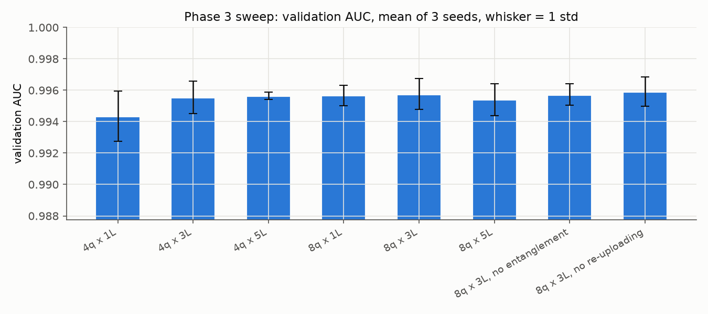
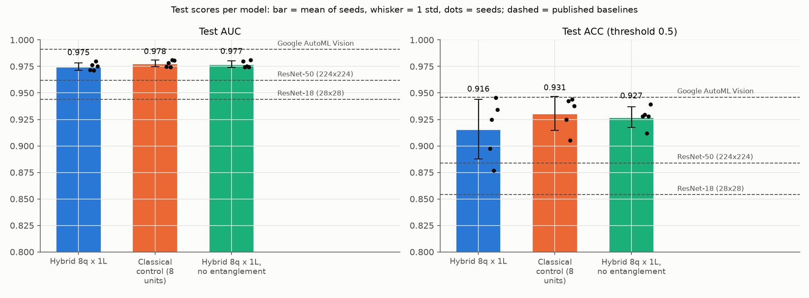
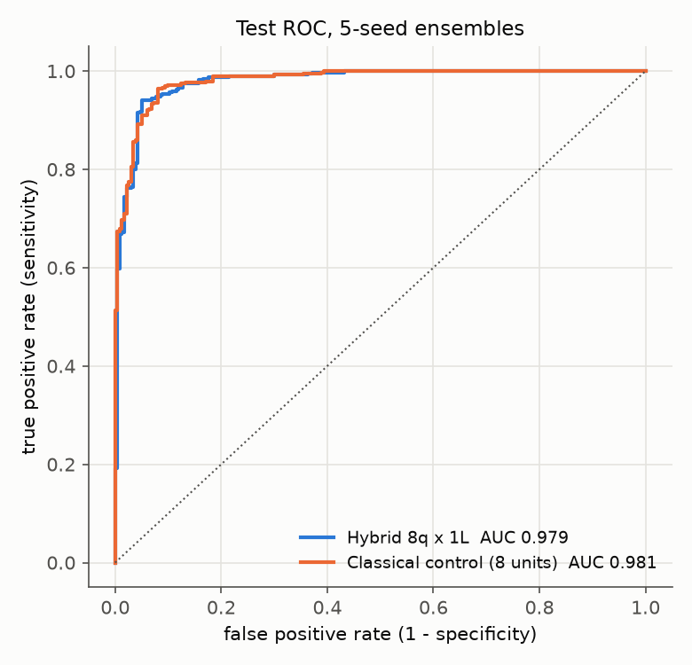
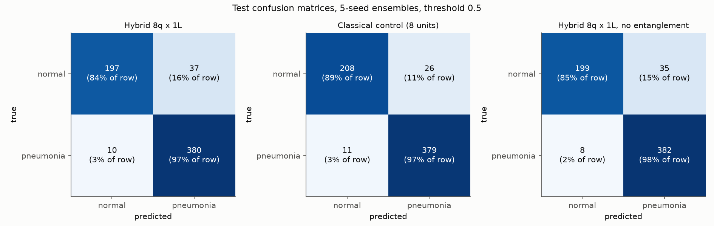
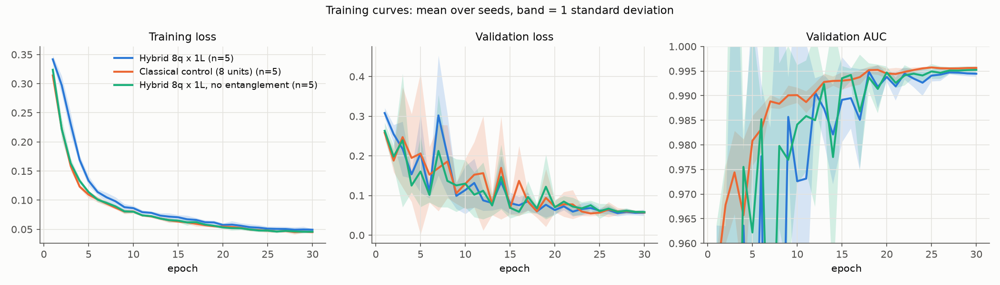
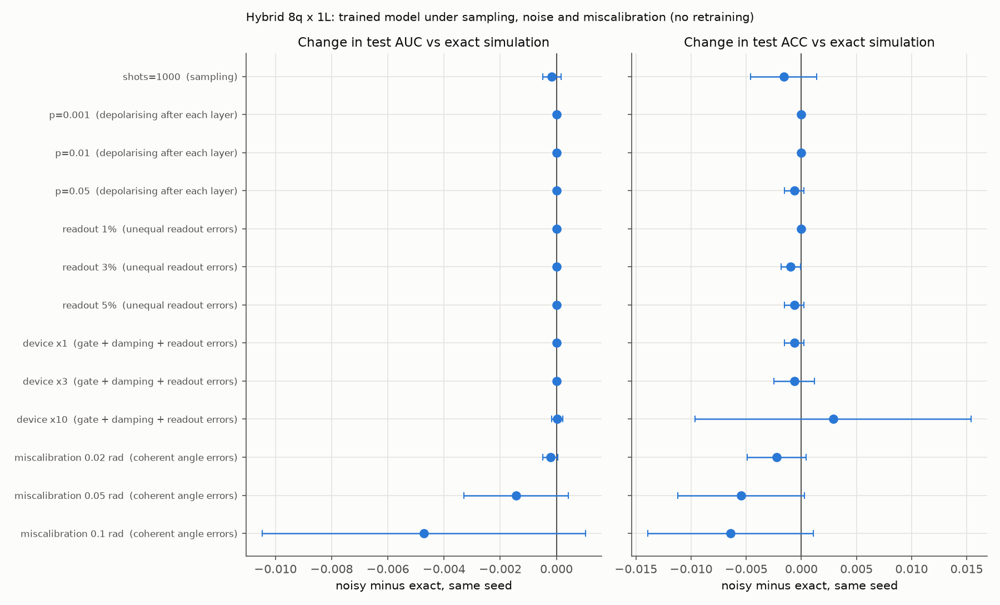
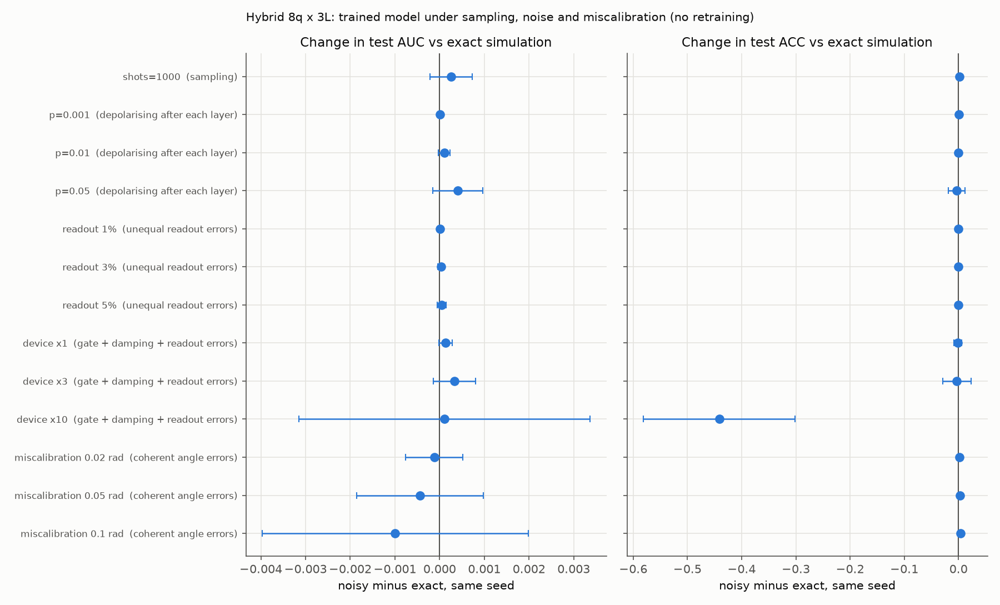

# Report: a hybrid quantum-classical classifier for PneumoniaMNIST

Study project. Simulation only; not for clinical use. Every number in the tables below is generated by
`src/evaluate.py` from the files in `runs/`; the surrounding text only interprets them.

## 1. Problem

Binary classification of paediatric chest X-rays (normal vs pneumonia) at 28 x 28 pixels. The question is
not only "how accurate can a hybrid quantum-classical model be?" but "does the quantum part help, compared
with a classical block of the same size trained the same way?". The second question is the scientific
content of the project.

## 2. Dataset

PneumoniaMNIST (MedMNIST v2, CC BY 4.0): 5,856 paediatric chest X-rays (originally collected by Kermany et
al.), centre-cropped and resized to 1 x 28 x 28. Counts are asserted at load time:

| Split | Images | Normal | Pneumonia | Pneumonia share |
|---|---|---|---|---|
| train | 4,708 | 1,214 | 3,494 | 74.2% |
| validation | 524 | 135 | 389 | 74.2% |
| test | 624 | 234 | 390 | 62.5% |

The test split is the original source's separate test set and has a different class balance. Validation
scores are therefore systematically higher than test scores; no attempt was made to "fix" this with test data.

## 3. Method

**Models.** A small CNN backbone (four 3 x 3 conv-BN-ReLU blocks, two max-pools, global average pooling;
60,400 weights) maps the image to 64 features. `Linear(64, 8)` followed by `pi * tanh` produces 8 angles.
The *middle block* maps 8 -> 8, and `Linear(8, 1)` gives the logit.

- *Hybrid*: the middle block is a variational circuit on 8 qubits (PennyLane `default.qubit`, exact
  state-vector simulation, backpropagation). Each of 3 layers applies `RY` angle encoding of the 8 inputs
  (data re-uploading), a trainable `Rot` on every qubit and a ring of CNOTs
  (`StronglyEntanglingLayers`); the outputs are `<Z>` on every qubit. 3 x 8 x 3 = 72 angles, initialised
  from N(0, 0.1) to avoid a barren plateau.
- *Classical control*: the middle block is `Linear(8, 8)` + `tanh` (64 + 8 = 72 weights).
- *No-entanglement ablation*: the hybrid circuit with the CNOTs removed.

Both main models have 61,001 trainable parameters. One subtlety, found by the gradient test: the last
layer's final `RZ(omega)` rotations are followed only by CNOTs and a Z measurement, which commute with
RZ, so those 8 angles cannot affect the output. The hybrid's middle block therefore has **64 effective
parameters against the control's 72**. The tables report both numbers.

**Training.** Weighted binary cross-entropy (`pos_weight` = 1,214 / 3,494, so both classes contribute
equally); AdamW with classical lr 1e-3 / weight decay 1e-4 and circuit lr 1e-2 / no decay; OneCycle schedule
(15% warm-up); gradient clipping at 1.0; batch 64; 30 epochs; augmentation by random rotation (10 degrees),
shift (8%) and zoom (0.9-1.1), no flips. CPU only, 2 threads per run.

## 4. Protocol

- The checkpoint of each run is the epoch with the best validation AUC (ties: lower validation loss). This
  rule was fixed before the first run.
- Settings were chosen on validation data only (Section 5). The test split is read by `evaluate.py` alone,
  once per final checkpoint, after the configuration was frozen; `train.py` never imports it.
- Every headline number is the mean ± sample standard deviation over seeds 0-4. The 5-seed ensemble
  (mean probability) is reported with 95% bootstrap confidence intervals (2,000 resamples of the 624 test images).
- Primary metrics are AUC and ACC at threshold 0.5, computed by the official MedMNIST `Evaluator` and
  asserted equal to our scikit-learn values. Sensitivity, specificity, precision, F1 and balanced accuracy
  are also reported.
- Decision rule (fixed in advance): if the difference in means is smaller than the (larger) seed standard
  deviation, or the ensemble confidence intervals overlap, the result is "no significant difference".

## 5. Phase 3: circuit sweep (validation only)

<!-- results:sweep -->
| Setting | Seeds | Circuit params | Val AUC | Val loss | Val ACC | Mean best epoch | Epoch time (s) |
|---|---|---|---|---|---|---|---|
| 4q x 1L | 3 | 12 | 0.9943 ± 0.0016 | 0.0679 ± 0.0122 | 0.956 | 26.0 | 45.4 |
| 4q x 3L | 3 | 36 | 0.9955 ± 0.0010 | 0.0547 ± 0.0019 | 0.962 | 21.0 | 48.1 |
| 4q x 5L | 3 | 60 | 0.9956 ± 0.0002 | 0.0556 ± 0.0061 | 0.965 | 23.0 | 41.0 |
| 8q x 1L | 3 | 24 | 0.9957 ± 0.0006 | 0.0559 ± 0.0087 | 0.964 | 19.3 | 20.7 |
| 8q x 3L | 3 | 72 | 0.9958 ± 0.0010 | 0.0553 ± 0.0035 | 0.971 | 20.7 | 23.5 |
| 8q x 5L | 3 | 120 | 0.9954 ± 0.0010 | 0.0545 ± 0.0021 | 0.961 | 19.3 | 34.9 |
| 8q x 3L, no entanglement | 3 | 72 | 0.9957 ± 0.0007 | 0.0470 ± 0.0022 | 0.964 | 22.0 | 26.3 |
| 8q x 3L, no re-uploading | 3 | 72 | 0.9959 ± 0.0009 | 0.0535 ± 0.0057 | 0.961 | 20.3 | 16.6 |

Validation split only (524 images); mean ± sample std over seeds 0-2. Checkpoint = epoch with the best validation AUC. Epoch times measured with up to 8 runs sharing the CPU.
<!-- /results:sweep -->

All eight settings reach practically the same validation AUC: the spread between settings is no larger than
the seed-to-seed spread within a setting, so validation AUC cannot rank these circuits. Width (4 or 8 qubits),
depth (1, 3 or 5 layers), entanglement and re-uploading all leave it unchanged within noise. Validation loss
separates two settings: the 4-qubit, 1-layer circuit is worse and less stable, and the circuit **without
entanglement has clearly the lowest loss** (better-calibrated probabilities at the same ranking quality).

Following the brief's rule (when settings tie, prefer the smaller circuit), the final hybrid is
**8 qubits x 1 layer**: the smallest circuit that ties with the best setting on both validation AUC and
validation loss, by the same "difference smaller than the seed standard deviation" test used later for the
main comparison. The full reasoning, including why 4 x 3 was not preferred, is in `DECISIONS.md`. Because this
circuit has 24 angles (16 effective) against the classical control's 72 weights, the parameter-matched
8 x 3 circuit was added as a secondary comparison before any test score was computed (Section 6.2).

## 6. Results on the test set

<!-- results:main -->
| Model | Params: total / compared block (effective) | Seeds | Test AUC | Test ACC | Sensitivity | Specificity | Balanced acc. | Ensemble AUC [95% CI] | Ensemble ACC [95% CI] |
|---|---|---|---|---|---|---|---|---|---|
| Hybrid 8q x 1L | 60,953 / 24 (16) | 5 | 0.975 ± 0.004 | 0.916 ± 0.028 | 0.971 ± 0.016 | 0.823 ± 0.095 | 0.897 ± 0.041 | 0.979 [0.967, 0.989] | 0.925 [0.904, 0.946] |
| Classical control (8 units) | 61,001 / 72 (72) | 5 | 0.978 ± 0.003 | 0.931 ± 0.016 | 0.966 ± 0.016 | 0.872 ± 0.058 | 0.919 ± 0.024 | 0.981 [0.971, 0.989] | 0.941 [0.921, 0.958] |
| Hybrid 8q x 1L, no entanglement | 60,953 / 24 (16) | 5 | 0.977 ± 0.003 | 0.927 ± 0.010 | 0.975 ± 0.010 | 0.848 ± 0.041 | 0.911 ± 0.016 | 0.981 [0.970, 0.990] | 0.931 [0.909, 0.950] |

Mean ± sample standard deviation over seeds; ACC, sensitivity and specificity at threshold 0.5. Ensemble = average of the seeds' probabilities; CI = 2,000 bootstrap resamples of the 624 test images. Compared block = the 8 -> 8 middle block, or the 2x2 front end for the quanvolution models. 'Effective' excludes the last-layer RZ angles that provably cannot affect the circuit output.
<!-- /results:main -->

<!-- results:target -->
Target (beat ResNet-18 at 28x28, AUC 0.944 / ACC 0.854): Hybrid 8q x 1L mean test AUC 0.975 (+0.031), ACC 0.916 (+0.062) over 5 seeds: **met**.
<!-- /results:target -->

Per seed (validation AUC shown for comparison):

<!-- results:seeds -->
| Model | Metric | seed 0 | seed 1 | seed 2 | seed 3 | seed 4 |
|---|---|---|---|---|---|---|
| Hybrid 8q x 1L | val AUC | 0.995 | 0.996 | 0.996 | 0.995 | 0.996 |
| Hybrid 8q x 1L | test AUC | 0.971 | 0.976 | 0.971 | 0.980 | 0.975 |
| Hybrid 8q x 1L | test ACC | 0.897 | 0.925 | 0.877 | 0.946 | 0.934 |
| Hybrid 8q x 1L | test sensitivity | 0.969 | 0.985 | 0.990 | 0.962 | 0.951 |
| Hybrid 8q x 1L | test specificity | 0.778 | 0.825 | 0.688 | 0.919 | 0.906 |
| Classical control (8 units) | val AUC | 0.996 | 0.996 | 0.996 | 0.996 | 0.996 |
| Classical control (8 units) | test AUC | 0.975 | 0.978 | 0.974 | 0.981 | 0.981 |
| Classical control (8 units) | test ACC | 0.925 | 0.942 | 0.905 | 0.944 | 0.938 |
| Classical control (8 units) | test sensitivity | 0.946 | 0.959 | 0.987 | 0.977 | 0.962 |
| Classical control (8 units) | test specificity | 0.889 | 0.915 | 0.769 | 0.889 | 0.897 |
| Hybrid 8q x 1L, no entanglement | val AUC | 0.997 | 0.997 | 0.996 | 0.996 | 0.995 |
| Hybrid 8q x 1L, no entanglement | test AUC | 0.980 | 0.974 | 0.975 | 0.975 | 0.981 |
| Hybrid 8q x 1L, no entanglement | test ACC | 0.928 | 0.929 | 0.912 | 0.928 | 0.939 |
| Hybrid 8q x 1L, no entanglement | test sensitivity | 0.977 | 0.979 | 0.985 | 0.974 | 0.959 |
| Hybrid 8q x 1L, no entanglement | test specificity | 0.846 | 0.846 | 0.791 | 0.850 | 0.906 |
<!-- /results:seeds -->

Published baselines for reference (different models and protocol; they are context, not a matched comparison):

<!-- results:baselines -->
| Published method (MedMNIST v2, Table 3) | Test AUC | Test ACC |
|---|---|---|
| ResNet-18 (28x28) | 0.944 | 0.854 |
| ResNet-18 (224x224) | 0.956 | 0.864 |
| ResNet-50 (28x28) | 0.948 | 0.854 |
| ResNet-50 (224x224) | 0.962 | 0.884 |
| auto-sklearn | 0.942 | 0.855 |
| AutoKeras | 0.947 | 0.878 |
| Google AutoML Vision | 0.991 | 0.946 |
<!-- /results:baselines -->

### 6.1 Did the quantum layer help?

<!-- results:compare -->
**A = Hybrid 8q x 1L, B = Classical control (8 units)**

| Metric | Mean A − B | Larger seed std | Ensemble 95% CI, A vs B | CIs overlap | Seeds where A > B | Verdict |
|---|---|---|---|---|---|---|
| AUC | -0.0031 | 0.0036 | [0.967, 0.989] vs [0.971, 0.989] | yes | 0 of 5 | **no significant difference** |
| ACC | -0.0151 | 0.0282 | [0.904, 0.946] vs [0.921, 0.958] | yes | 1 of 5 | **no significant difference** |

**A = Hybrid 8q x 1L, B = Hybrid 8q x 1L, no entanglement**

| Metric | Mean A − B | Larger seed std | Ensemble 95% CI, A vs B | CIs overlap | Seeds where A > B | Verdict |
|---|---|---|---|---|---|---|
| AUC | -0.0022 | 0.0036 | [0.967, 0.989] vs [0.970, 0.990] | yes | 2 of 5 | **no significant difference** |
| ACC | -0.0115 | 0.0282 | [0.904, 0.946] vs [0.909, 0.950] | yes | 1 of 5 | **no significant difference** |
<!-- /results:compare -->

**No. The quantum layer matched the classical control within noise and was slightly worse on mean AUC, mean
accuracy and both ensemble scores.** By the decision rule fixed before the test set was read, there is no significant difference on
either AUC or ACC: the mean differences are smaller than one seed standard deviation and the ensembles'
confidence intervals overlap almost completely. The direction, however, is consistent: the classical control
has the higher test AUC on every paired seed, the higher mean accuracy, and the better ensemble on both
metrics; the hybrid's only edge is a marginally higher sensitivity, paid for with a clearly lower specificity.
The honest summary is "statistically indistinguishable, and never ahead on the headline metrics".

The secondary, parameter-matched comparison (Section 6.2) gives the same answer, so the result does not
depend on the final hybrid having fewer parameters than the control.

**Sensitivity versus specificity.** All models catch almost every pneumonia case in the test set (high
sensitivity) and give most of their errors as false alarms on normal X-rays. The hybrid's specificity is lower
and more seed-dependent than the control's (see the per-seed table and the confusion matrices). For
screening, high sensitivity is the property that matters most, because a missed pneumonia costs more than a
second look at a healthy child; the price is extra false alarms. The drop in specificity from validation to
test is consistent with the dataset shift: the test split has proportionally more normal images, from a
different collection, than the data the model and its threshold were fitted on.

### 6.2 Secondary: parameter-matched 8 x 3 circuit (72 vs 72)

<!-- results:matched -->
| Model | Params: total / compared block (effective) | Seeds | Test AUC | Test ACC | Sensitivity | Specificity | Balanced acc. | Ensemble AUC [95% CI] | Ensemble ACC [95% CI] |
|---|---|---|---|---|---|---|---|---|---|
| Hybrid 8q x 3L | 61,001 / 72 (64) | 5 | 0.975 ± 0.004 | 0.916 ± 0.023 | 0.984 ± 0.010 | 0.803 ± 0.076 | 0.894 ± 0.033 | 0.980 [0.969, 0.990] | 0.920 [0.897, 0.941] |
| Classical control (8 units) | 61,001 / 72 (72) | 5 | 0.978 ± 0.003 | 0.931 ± 0.016 | 0.966 ± 0.016 | 0.872 ± 0.058 | 0.919 ± 0.024 | 0.981 [0.971, 0.989] | 0.941 [0.921, 0.958] |

Mean ± sample standard deviation over seeds; ACC, sensitivity and specificity at threshold 0.5. Ensemble = average of the seeds' probabilities; CI = 2,000 bootstrap resamples of the 624 test images. Compared block = the 8 -> 8 middle block, or the 2x2 front end for the quanvolution models. 'Effective' excludes the last-layer RZ angles that provably cannot affect the circuit output.

**A = Hybrid 8q x 3L, B = Classical control (8 units)**

| Metric | Mean A − B | Larger seed std | Ensemble 95% CI, A vs B | CIs overlap | Seeds where A > B | Verdict |
|---|---|---|---|---|---|---|
| AUC | -0.0026 | 0.0040 | [0.969, 0.990] vs [0.971, 0.989] | yes | 2 of 5 | **no significant difference** |
| ACC | -0.0144 | 0.0225 | [0.897, 0.941] vs [0.921, 0.958] | yes | 1 of 5 | **no significant difference** |
<!-- /results:matched -->

### 6.3 Secondary: a threshold tuned on validation data

<!-- results:threshold -->
| Model | Val-tuned threshold | Test ACC at 0.5 | Test ACC at tuned | Sensitivity at tuned | Specificity at tuned | Balanced acc. at tuned | Ensemble ACC at tuned |
|---|---|---|---|---|---|---|---|
| Hybrid 8q x 1L | 0.444 ± 0.331 | 0.916 ± 0.028 | 0.919 ± 0.015 | 0.979 ± 0.007 | 0.818 ± 0.038 | 0.899 ± 0.020 | 0.925 (t = 0.409) |
| Classical control (8 units) | 0.179 ± 0.089 | 0.931 ± 0.016 | 0.904 ± 0.026 | 0.987 ± 0.006 | 0.765 ± 0.074 | 0.876 ± 0.035 | 0.920 (t = 0.257) |
| Hybrid 8q x 1L, no entanglement | 0.337 ± 0.187 | 0.927 ± 0.010 | 0.913 ± 0.015 | 0.986 ± 0.005 | 0.791 ± 0.046 | 0.889 ± 0.021 | 0.925 (t = 0.396) |
| Hybrid 8q x 3L | 0.405 ± 0.210 | 0.916 ± 0.023 | 0.908 ± 0.019 | 0.988 ± 0.009 | 0.775 ± 0.066 | 0.881 ± 0.029 | 0.899 (t = 0.334) |

Secondary result. Each threshold is chosen on validation data only (largest sensitivity + specificity); the test set never influences it. The headline numbers keep the fixed 0.5 threshold.
<!-- /results:threshold -->

Moving the decision threshold away from 0.5 using validation data does **not** help, as the brief's prototype
had warned. Validation is almost perfectly separable, so the "best" threshold is poorly determined (its spread
across seeds is very large for the hybrid), and the tuned thresholds sit below 0.5. Lowering the threshold buys
a little sensitivity but loses more specificity on the test set, whose class balance differs from validation,
so accuracy falls for most models. The fixed 0.5 threshold stays the headline.

## 7. Ablations

**Entanglement (Phase 4, test set; second table in Section 6.1).** Removing every CNOT did not hurt. The
no-entanglement circuit's means are slightly above the entangled circuit's on both metrics and its accuracy
varies less between seeds; by the decision rule the difference is not significant. On validation (Section 5)
it also had the lowest loss of any setting. So entanglement, the one ingredient that makes the circuit
"quantum" in an interesting sense, brought no measurable benefit here.

**Why: what the final circuit actually computes.** For one layer the circuit has an exact closed form
(checked to 1e-5 by `tests/test_smoke.py::test_one_layer_circuit_has_closed_form`). Each qubit on its own
returns

    c_i = cos(theta_i) cos(x_i) - sin(theta_i) cos(phi_i) sin(x_i)  =  r_i cos(x_i + delta_i),  r_i <= 1,

a learned, phase-shifted cosine of its input with two effective parameters (the third angle has no effect,
as noted in Section 3). Without CNOTs, these eight cosines *are* the outputs: the "quantum layer" is a
sinusoidal activation function. With the CNOT ring, output k becomes the product c_0 c_1 ... c_k (and output 0
the product c_1 ... c_7). Products of up to eight numbers of magnitude at most 1 shrink towards zero unless
the network keeps every factor near +-1, so the entangled outputs are a more constrained set of features than
the eight separate cosines. That restrictive inductive bias is a plausible reason why entanglement did not
help; this study does not test it further. Deeper circuits with re-uploading have no such simple form, but
the sweep found no validation benefit from depth either.

**Re-uploading and depth (Phase 3, validation only).** Encoding the data once instead of before every layer,
and using 1, 3 or 5 layers, made no difference beyond seed noise. With validation AUC saturated near its
ceiling, the sweep cannot detect small effects; it does show that nothing about the circuit's design is a
large lever on this task.

## 8. Extensions (reported separately from the main result)

### 8.1 Finite shots and hardware-like noise

<!-- results:noise -->
| Circuit simulation | Kind of error | Test AUC | Test ACC | Δ AUC vs exact (paired) | Δ ACC vs exact (paired) |
|---|---|---|---|---|---|
| exact simulation | none | 0.9748 ± 0.0036 | 0.916 ± 0.028 | +0.0000 ± 0.0000 | +0.0000 ± 0.0000 |
| shots=1000 | sampling | 0.9746 ± 0.0037 | 0.914 ± 0.031 | -0.0002 ± 0.0003 | -0.0016 ± 0.0030 |
| p=0.001 | depolarising after each layer | 0.9748 ± 0.0036 | 0.916 ± 0.028 | +0.0000 ± 0.0000 | +0.0000 ± 0.0000 |
| p=0.01 | depolarising after each layer | 0.9748 ± 0.0036 | 0.916 ± 0.028 | +0.0000 ± 0.0000 | +0.0000 ± 0.0000 |
| p=0.05 | depolarising after each layer | 0.9748 ± 0.0036 | 0.915 ± 0.029 | +0.0000 ± 0.0000 | -0.0006 ± 0.0009 |
| readout 1% | unequal readout errors | 0.9748 ± 0.0036 | 0.916 ± 0.028 | +0.0000 ± 0.0000 | +0.0000 ± 0.0000 |
| readout 3% | unequal readout errors | 0.9748 ± 0.0036 | 0.915 ± 0.029 | +0.0000 ± 0.0000 | -0.0010 ± 0.0009 |
| readout 5% | unequal readout errors | 0.9748 ± 0.0036 | 0.915 ± 0.029 | +0.0000 ± 0.0000 | -0.0006 ± 0.0009 |
| device x1 | gate + damping + readout errors | 0.9748 ± 0.0036 | 0.915 ± 0.029 | +0.0000 ± 0.0000 | -0.0006 ± 0.0009 |
| device x3 | gate + damping + readout errors | 0.9748 ± 0.0036 | 0.915 ± 0.027 | +0.0000 ± 0.0001 | -0.0006 ± 0.0018 |
| device x10 | gate + damping + readout errors | 0.9748 ± 0.0035 | 0.919 ± 0.030 | +0.0000 ± 0.0002 | +0.0029 ± 0.0125 |
| miscalibration 0.02 rad | coherent angle errors | 0.9746 ± 0.0036 | 0.913 ± 0.028 | -0.0002 ± 0.0003 | -0.0022 ± 0.0027 |
| miscalibration 0.05 rad | coherent angle errors | 0.9733 ± 0.0040 | 0.910 ± 0.030 | -0.0014 ± 0.0019 | -0.0054 ± 0.0057 |
| miscalibration 0.1 rad | coherent angle errors | 0.9701 ± 0.0076 | 0.909 ± 0.032 | -0.0047 ± 0.0058 | -0.0064 ± 0.0075 |

Same trained weights, no retraining; mean ± std over 5 seeds; Δ = noisy minus exact for the same seed. shots: each <Z> estimated from 1,000 measurements. p: depolarising channel on every qubit after every layer. readout: unequal per-qubit bit-flip errors with this mean. device xk: 0.1% single-qubit and 1% two-qubit gate errors, 0.1% amplitude and phase damping per layer and 2% mean readout error, all multiplied by k. miscalibration: every circuit angle off by a fixed random N(0, sigma) amount. Order-of-magnitude illustrations, not calibrated models of a real device.
<!-- /results:noise -->

The same evaluation on the 3-layer, parameter-matched circuit, where noise also acts between layers:

<!-- results:noise_matched -->
| Circuit simulation | Kind of error | Test AUC | Test ACC | Δ AUC vs exact (paired) | Δ ACC vs exact (paired) |
|---|---|---|---|---|---|
| exact simulation | none | 0.9753 ± 0.0040 | 0.916 ± 0.023 | +0.0000 ± 0.0000 | +0.0000 ± 0.0000 |
| shots=1000 | sampling | 0.9755 ± 0.0039 | 0.918 ± 0.023 | +0.0003 ± 0.0005 | +0.0019 ± 0.0013 |
| p=0.001 | depolarising after each layer | 0.9753 ± 0.0040 | 0.917 ± 0.022 | +0.0000 ± 0.0000 | +0.0003 ± 0.0007 |
| p=0.01 | depolarising after each layer | 0.9754 ± 0.0039 | 0.916 ± 0.022 | +0.0001 ± 0.0001 | +0.0000 ± 0.0034 |
| p=0.05 | depolarising after each layer | 0.9757 ± 0.0037 | 0.913 ± 0.028 | +0.0004 ± 0.0006 | -0.0032 ± 0.0150 |
| readout 1% | unequal readout errors | 0.9753 ± 0.0040 | 0.916 ± 0.023 | +0.0000 ± 0.0000 | +0.0000 ± 0.0000 |
| readout 3% | unequal readout errors | 0.9753 ± 0.0039 | 0.916 ± 0.022 | +0.0000 ± 0.0001 | +0.0000 ± 0.0011 |
| readout 5% | unequal readout errors | 0.9753 ± 0.0039 | 0.916 ± 0.023 | +0.0000 ± 0.0001 | -0.0003 ± 0.0018 |
| device x1 | gate + damping + readout errors | 0.9754 ± 0.0039 | 0.915 ± 0.024 | +0.0001 ± 0.0002 | -0.0013 ± 0.0076 |
| device x3 | gate + damping + readout errors | 0.9756 ± 0.0038 | 0.913 ± 0.036 | +0.0003 ± 0.0005 | -0.0029 ± 0.0262 |
| device x10 | gate + damping + readout errors | 0.9754 ± 0.0059 | 0.475 ± 0.137 | +0.0001 ± 0.0033 | -0.4413 ± 0.1399 |
| miscalibration 0.02 rad | coherent angle errors | 0.9751 ± 0.0043 | 0.918 ± 0.023 | -0.0001 ± 0.0006 | +0.0019 ± 0.0026 |
| miscalibration 0.05 rad | coherent angle errors | 0.9748 ± 0.0048 | 0.920 ± 0.023 | -0.0004 ± 0.0014 | +0.0032 ± 0.0041 |
| miscalibration 0.1 rad | coherent angle errors | 0.9743 ± 0.0059 | 0.921 ± 0.022 | -0.0010 ± 0.0030 | +0.0042 ± 0.0046 |

Same trained weights, no retraining; mean ± std over 5 seeds; Δ = noisy minus exact for the same seed. shots: each <Z> estimated from 1,000 measurements. p: depolarising channel on every qubit after every layer. readout: unequal per-qubit bit-flip errors with this mean. device xk: 0.1% single-qubit and 1% two-qubit gate errors, 0.1% amplitude and phase damping per layer and 2% mean readout error, all multiplied by k. miscalibration: every circuit angle off by a fixed random N(0, sigma) amount. Order-of-magnitude illustrations, not calibrated models of a real device.
<!-- /results:noise_matched -->

The trained hybrids were re-evaluated without retraining under five kinds of error: sampling (each `<Z>`
estimated from 1,000 shots, as a real device must), depolarising noise after every layer, unequal per-qubit
readout errors, a gate-by-gate device profile (single- and two-qubit gate errors, amplitude and phase damping,
readout errors) at one, three and ten times a rough present-day strength, and coherent miscalibration (every
circuit angle off by a fixed random amount). Three findings:

1. **Ranking (AUC) survives every incoherent error**, at every strength, for both circuits. Depolarising noise,
   damping and readout errors mostly shrink each `<Z>` towards zero. The linear head turns a shrink into a
   change of scale of the logit, which barely reorders patients. For the 1-layer circuit with equal noise on
   every qubit this is exact (AUC cannot change at all); with unequal readout errors and gate-by-gate noise it
   still holds to within the table's rounding.
2. **Calibration does not survive heavy noise.** For the 3-layer circuit at ten times the device profile, the
   noise accumulates over three layers, the outputs shrink so far that most logits fall on the same side of the
   fixed 0.5 threshold, and accuracy collapses although AUC is unchanged. A real deployment would have to re-fit
   the head (or the threshold) on the noisy device; the ranking information is still there.
3. **Coherent miscalibration is the error that actually changes the function**, and for the 1-layer model it is
   the only one that lowers AUC, more so as the angle errors grow. The effect is still small at these sizes,
   because the CNN in front does most of the work.

Caveats: the strengths are order-of-magnitude guesses, not a calibrated device model, and there is no crosstalk,
leakage or connectivity constraint. Robustness of a model whose quantum block adds nothing over a classical one
is also a weaker statement than it sounds: a block that contributes little has little to lose.

### 8.2 Trainable quanvolution front end

<!-- results:quanv -->
| Model | Params: total / compared block (effective) | Seeds | Test AUC | Test ACC | Sensitivity | Specificity | Balanced acc. | Ensemble AUC [95% CI] | Ensemble ACC [95% CI] |
|---|---|---|---|---|---|---|---|---|---|
| Quanvolution front end | 56,857 / 24 (20) | 5 | 0.973 ± 0.001 | 0.916 ± 0.017 | 0.929 ± 0.040 | 0.895 ± 0.079 | 0.912 ± 0.026 | 0.976 [0.964, 0.985] | 0.934 [0.915, 0.954] |
| Conv 2x2 control | 56,853 / 20 (20) | 5 | 0.977 ± 0.002 | 0.927 ± 0.009 | 0.934 ± 0.016 | 0.915 ± 0.020 | 0.925 ± 0.009 | 0.979 [0.969, 0.988] | 0.933 [0.913, 0.952] |

Mean ± sample standard deviation over seeds; ACC, sensitivity and specificity at threshold 0.5. Ensemble = average of the seeds' probabilities; CI = 2,000 bootstrap resamples of the 624 test images. Compared block = the 8 -> 8 middle block, or the 2x2 front end for the quanvolution models. 'Effective' excludes the last-layer RZ angles that provably cannot affect the circuit output.

**A = Quanvolution front end, B = Conv 2x2 control**

| Metric | Mean A − B | Larger seed std | Ensemble 95% CI, A vs B | CIs overlap | Seeds where A > B | Verdict |
|---|---|---|---|---|---|---|
| AUC | -0.0036 | 0.0023 | [0.964, 0.985] vs [0.969, 0.988] | yes | 1 of 5 | **no significant difference** |
| ACC | -0.0109 | 0.0174 | [0.915, 0.954] vs [0.913, 0.952] | yes | 1 of 5 | **no significant difference** |
<!-- /results:quanv -->

A 4-qubit, 2-layer circuit replaces the first convolution: it reads every non-overlapping 2 x 2 patch of the
image as four rotation angles and outputs four feature maps. Its control is a 2 x 2, stride-2 convolution with
four channels and `tanh`; both feed the same reduced CNN and head, and both compared blocks have 20 effective
parameters. The result repeats the main finding. The quantum front end trains to a competitive score, but the
plain convolution has the higher AUC on most seeds. The AUC gap is larger than the seed standard deviation,
yet the ensemble confidence intervals overlap, so by the fixed rule it is "no significant difference"; the
ensembles' accuracies are indistinguishable. The quanvolution's specificity also varies much more between
seeds. It is the most expensive model in the project: it simulates one circuit per patch, 196 per image, which
makes its runs several times slower than the control's (Section 9).

### 8.3 Higher resolution (64 x 64, MedMNIST+)

<!-- results:s64 -->
| Model | Params: total / compared block (effective) | Seeds | Test AUC | Test ACC | Sensitivity | Specificity | Balanced acc. | Ensemble AUC [95% CI] | Ensemble ACC [95% CI] |
|---|---|---|---|---|---|---|---|---|---|
| Hybrid 8q x 1L, 64x64 | 60,953 / 24 (16) | 5 | 0.966 ± 0.007 | 0.911 ± 0.022 | 0.964 ± 0.017 | 0.823 ± 0.077 | 0.894 ± 0.032 | 0.974 [0.962, 0.985] | 0.925 [0.904, 0.944] |
| Classical control (8 units), 64x64 | 61,001 / 72 (72) | 5 | 0.973 ± 0.002 | 0.926 ± 0.008 | 0.936 ± 0.013 | 0.908 ± 0.012 | 0.922 ± 0.007 | 0.975 [0.962, 0.985] | 0.933 [0.913, 0.950] |

Mean ± sample standard deviation over seeds; ACC, sensitivity and specificity at threshold 0.5. Ensemble = average of the seeds' probabilities; CI = 2,000 bootstrap resamples of the 624 test images. Compared block = the 8 -> 8 middle block, or the 2x2 front end for the quanvolution models. 'Effective' excludes the last-layer RZ angles that provably cannot affect the circuit output.

**A = Hybrid 8q x 1L, 64x64, B = Classical control (8 units), 64x64**

| Metric | Mean A − B | Larger seed std | Ensemble 95% CI, A vs B | CIs overlap | Seeds where A > B | Verdict |
|---|---|---|---|---|---|---|
| AUC | -0.0071 | 0.0072 | [0.962, 0.985] vs [0.962, 0.985] | yes | 0 of 5 | **no significant difference** |
| ACC | -0.0144 | 0.0216 | [0.904, 0.944] vs [0.913, 0.950] | yes | 1 of 5 | **no significant difference** |
<!-- /results:s64 -->

The final hybrid and its control, retrained unchanged on the 64 x 64 MedMNIST+ version of the same images and
splits. These numbers are **not comparable with the 28 x 28 baselines**. Two observations. First, the
quantum-vs-classical pattern is the same as at 28 x 28: no significant difference by the fixed rule, with the
classical control ahead in mean AUC and accuracy, ahead on AUC for every paired seed, and with much smaller
seed-to-seed spread; the hybrid again buys a little sensitivity with a larger loss of specificity.
Second, neither model gained from the higher resolution; both score slightly below their 28 x 28 versions. The
backbone, augmentation and 30-epoch schedule were designed for 28 x 28 and were deliberately not re-tuned (that
would have meant selecting on these results), so this says only that more pixels are not free accuracy for
this small network, not that 64 x 64 images carry less information.

### 8.4 Post-hoc improvements (Phase 7)

After the main study, two standard improvements were tried on the hybrid and the control alike: a longer
schedule with weight averaging (*v2*: 60 epochs, exponential moving average of the weights) and test-time
augmentation (*TTA*: the probability averaged over seven slightly shifted or rotated views). The decision rule
was written into `DECISIONS.md` before any Phase 7 number was computed, and applied on validation data only:

<!-- results:phase7_val -->
| Model | Variant | Seeds | Val AUC | Val loss | Δ val AUC vs v1 | Δ val loss vs v1 |
|---|---|---|---|---|---|---|
| hybrid | v1 | 5 | 0.9956 ± 0.0005 | 0.0600 ± 0.0084 | +0.0000 | +0.0000 |
| hybrid | v1 + TTA | 5 | 0.9970 ± 0.0007 | 0.0515 ± 0.0112 | +0.0014 | -0.0085 |
| hybrid | v2 | 5 | 0.9965 ± 0.0006 | 0.0505 ± 0.0129 | +0.0010 | -0.0095 |
| hybrid | v2 + TTA | 5 | 0.9975 ± 0.0004 | 0.0409 ± 0.0065 | +0.0019 | -0.0191 |
| classical | v1 | 5 | 0.9960 ± 0.0004 | 0.0588 ± 0.0134 | +0.0000 | +0.0000 |
| classical | v1 + TTA | 5 | 0.9971 ± 0.0002 | 0.0442 ± 0.0061 | +0.0011 | -0.0146 |
| classical | v2 | 5 | 0.9967 ± 0.0007 | 0.0486 ± 0.0090 | +0.0006 | -0.0102 |
| classical | v2 + TTA | 5 | 0.9976 ± 0.0004 | 0.0351 ± 0.0030 | +0.0016 | -0.0236 |

Validation only. v1 = the main recipe (30 epochs); v2 = 60 epochs + weight averaging (EMA); TTA = probability averaged over 7 shifted/rotated views. Rule fixed in advance: a candidate is adopted only if, for both the hybrid and the control, it lowers mean validation loss without lowering mean validation AUC.

- **TTA: adopted** by that rule.
- **recipe v2: adopted** by that rule.
<!-- /results:phase7_val -->

Both candidates passed the validation rule. Because the test set had already been read in Phase 4, the test
scores below are **exploratory**: they are reported whatever the validation verdict and do not replace the
headline result.

<!-- results:phase7 -->
**Post-hoc, exploratory**: the test set had already been read once (Phase 4). These rows are reported whatever the validation verdict, and none of them replaces the headline result.

| Model | Params: total / compared block (effective) | Seeds | Test AUC | Test ACC | Sensitivity | Specificity | Balanced acc. | Ensemble AUC [95% CI] | Ensemble ACC [95% CI] |
|---|---|---|---|---|---|---|---|---|---|
| Hybrid 8q x 1L | 60,953 / 24 (16) | 5 | 0.975 ± 0.004 | 0.916 ± 0.028 | 0.971 ± 0.016 | 0.823 ± 0.095 | 0.897 ± 0.041 | 0.979 [0.967, 0.989] | 0.925 [0.904, 0.946] |
| Hybrid 8q x 1L + TTA | 60,953 / 24 (16) | 5 | 0.974 ± 0.002 | 0.891 ± 0.036 | 0.986 ± 0.011 | 0.733 ± 0.112 | 0.859 ± 0.051 | 0.977 [0.964, 0.987] | 0.910 [0.886, 0.933] |
| Hybrid 8q x 1L, 60 epochs, EMA | 60,953 / 24 (16) | 5 | 0.975 ± 0.010 | 0.931 ± 0.014 | 0.968 ± 0.019 | 0.869 ± 0.064 | 0.918 ± 0.024 | 0.980 [0.967, 0.990] | 0.942 [0.923, 0.960] |
| Hybrid 8q x 1L, 60 epochs, EMA + TTA | 60,953 / 24 (16) | 5 | 0.971 ± 0.016 | 0.915 ± 0.028 | 0.981 ± 0.014 | 0.806 ± 0.096 | 0.894 ± 0.041 | 0.976 [0.962, 0.988] | 0.925 [0.904, 0.946] |
| Classical control (8 units) | 61,001 / 72 (72) | 5 | 0.978 ± 0.003 | 0.931 ± 0.016 | 0.966 ± 0.016 | 0.872 ± 0.058 | 0.919 ± 0.024 | 0.981 [0.971, 0.989] | 0.941 [0.921, 0.958] |
| Classical control (8 units) + TTA | 61,001 / 72 (72) | 5 | 0.977 ± 0.003 | 0.915 ± 0.022 | 0.982 ± 0.011 | 0.804 ± 0.070 | 0.893 ± 0.031 | 0.980 [0.970, 0.989] | 0.918 [0.896, 0.939] |
| Classical control (8 units), 60 epochs, EMA | 61,001 / 72 (72) | 5 | 0.982 ± 0.002 | 0.941 ± 0.006 | 0.971 ± 0.012 | 0.891 ± 0.023 | 0.931 ± 0.008 | 0.984 [0.975, 0.992] | 0.949 [0.931, 0.965] |
| Classical control (8 units), 60 epochs, EMA + TTA | 61,001 / 72 (72) | 5 | 0.981 ± 0.002 | 0.927 ± 0.010 | 0.986 ± 0.007 | 0.830 ± 0.032 | 0.908 ± 0.014 | 0.982 [0.972, 0.991] | 0.929 [0.909, 0.949] |

Mean ± sample standard deviation over seeds; ACC, sensitivity and specificity at threshold 0.5. Ensemble = average of the seeds' probabilities; CI = 2,000 bootstrap resamples of the 624 test images. Compared block = the 8 -> 8 middle block, or the 2x2 front end for the quanvolution models. 'Effective' excludes the last-layer RZ angles that provably cannot affect the circuit output.

Hybrid vs classical control with the variant chosen on validation data (v2 + TTA):

**A = Hybrid 8q x 1L, 60 epochs, EMA + TTA, B = Classical control (8 units), 60 epochs, EMA + TTA**

| Metric | Mean A − B | Larger seed std | Ensemble 95% CI, A vs B | CIs overlap | Seeds where A > B | Verdict |
|---|---|---|---|---|---|---|
| AUC | -0.0104 | 0.0163 | [0.962, 0.988] vs [0.972, 0.991] | yes | 0 of 5 | **no significant difference** |
| ACC | -0.0119 | 0.0280 | [0.904, 0.946] vs [0.909, 0.949] | yes | 2 of 5 | **no significant difference** |

The same comparison for v2:

**A = Hybrid 8q x 1L, 60 epochs, EMA, B = Classical control (8 units), 60 epochs, EMA**

| Metric | Mean A − B | Larger seed std | Ensemble 95% CI, A vs B | CIs overlap | Seeds where A > B | Verdict |
|---|---|---|---|---|---|---|
| AUC | -0.0073 | 0.0103 | [0.967, 0.990] vs [0.975, 0.992] | yes | 1 of 5 | **no significant difference** |
| ACC | -0.0099 | 0.0143 | [0.923, 0.960] vs [0.931, 0.965] | yes | 2 of 5 | **no significant difference** |

The same comparison for v1 + TTA:

**A = Hybrid 8q x 1L + TTA, B = Classical control (8 units) + TTA**

| Metric | Mean A − B | Larger seed std | Ensemble 95% CI, A vs B | CIs overlap | Seeds where A > B | Verdict |
|---|---|---|---|---|---|---|
| AUC | -0.0029 | 0.0028 | [0.964, 0.987] vs [0.970, 0.989] | yes | 0 of 5 | **no significant difference** |
| ACC | -0.0244 | 0.0364 | [0.886, 0.933] vs [0.896, 0.939] | yes | 1 of 5 | **no significant difference** |
<!-- /results:phase7 -->

Two lessons.

1. **The longer schedule with weight averaging is a real improvement**, most clearly for the classical control:
   higher test AUC and accuracy and a much smaller spread across seeds. For the hybrid it raises accuracy, while
   its AUC stays the same on average and varies more between seeds. The strongest model of the whole project is
   therefore the classical control trained with recipe v2.
2. **Test-time augmentation looked better on validation and was worse on test.** It lowered validation loss for
   both models, so the pre-declared rule adopted it, yet it lowered test accuracy for every model, at unchanged
   AUC. Averaging over shifted views nudges the probabilities towards "pneumonia": validation (74% pneumonia)
   rewards that, the test set (62.5% pneumonia) punishes it with false alarms on normal X-rays, as the drop in
   specificity shows. It is the same validation-to-test shift that defeated the tuned threshold (Section 6.3):
   on this dataset, anything that moves the operating point does not carry over from validation to test. The
   rule said adopt, the test set disagreed, and both facts are reported rather than the rule being changed
   after the fact.

The quantum-vs-classical answer is the same under every variant: no significant difference by the fixed rule,
and the classical control has the higher mean AUC in all four.

## 9. Training diagnostics and compute

Circuit gradients (barren-plateau check):

<!-- results:gradients -->
| Run group | Runs | Smallest epoch mean | Largest epoch mean | Last epoch (mean over runs) |
|---|---|---|---|---|
| hybrid_q4_l1 | 3 | 4.1e-03 | 3.5e-02 | 2.4e-02 |
| hybrid_q4_l3 | 3 | 1.5e-02 | 6.4e-02 | 3.1e-02 |
| hybrid_q4_l5 | 3 | 1.8e-02 | 5.5e-02 | 4.1e-02 |
| hybrid_q8_l1 | 5 | 1.1e-02 | 6.5e-02 | 3.5e-02 |
| hybrid_q8_l1_e60_ema0.998 | 5 | 1.0e-02 | 7.6e-02 | 3.7e-02 |
| hybrid_q8_l1_noent | 5 | 1.1e-02 | 2.7e-02 | 1.6e-02 |
| hybrid_q8_l1_s64 | 5 | 1.2e-02 | 7.2e-02 | 4.3e-02 |
| hybrid_q8_l3 | 5 | 5.6e-03 | 6.1e-02 | 3.0e-02 |
| hybrid_q8_l3_noent | 3 | 1.7e-02 | 3.5e-02 | 2.2e-02 |
| hybrid_q8_l3_noreup | 3 | 1.6e-02 | 3.6e-02 | 2.3e-02 |
| hybrid_q8_l5 | 3 | 1.0e-02 | 4.5e-02 | 2.2e-02 |

L2 norm of the circuit-angle gradients, averaged over the steps of each epoch (before clipping). A barren plateau would show as values collapsing towards zero.
<!-- /results:gradients -->

Training time:

<!-- results:timing -->
| Model | Seeds | Mean epoch time (s) | Mean training run (min, 30 epochs) | Fastest run (min) |
|---|---|---|---|---|
| Hybrid 8q x 1L | 5 | 19.1 | 9.6 | 8.3 |
| Classical control (8 units) | 5 | 11.7 | 5.8 | 3.6 |
| Hybrid 8q x 1L, no entanglement | 5 | 17.1 | 8.5 | 8.2 |
| Hybrid 8q x 3L | 5 | 24.6 | 12.3 | 6.6 |
| Quanvolution front end | 5 | 57.0 | 28.5 | 25.0 |
| Conv 2x2 control | 5 | 9.2 | 4.6 | 3.8 |
| Hybrid 8q x 1L, 64x64 | 5 | 105.5 | 52.7 | 43.4 |
| Classical control (8 units), 64x64 | 5 | 78.3 | 39.2 | 28.6 |

CPU only, 2 PyTorch threads per run; up to 8 runs shared the 20-core CPU at once, so single-run times on an idle machine are shorter.
<!-- /results:timing -->

CPU or GPU? The brief asks to time an epoch on each device and keep the faster one:

<!-- results:devices -->
| Model | Device | CPU threads | PyTorch build | Seconds per epoch |
|---|---|---|---|---|
| hybrid (final, 8q x 1L) | cpu | 2 | 2.14.1+cu130 | 5.52 |
| classical control | cpu | 2 | 2.14.1+cu130 | 3.77 |
| hybrid (final, 8q x 1L) | cpu | 8 | 2.14.1+cu130 | 4.18 |
| classical control | cpu | 8 | 2.14.1+cu130 | 2.40 |
| hybrid (final, 8q x 1L) | cuda (NVIDIA GeForce RTX 5060 Laptop GPU) | 2 | 2.14.1+cu130 | 3.69 |
| classical control | cuda (NVIDIA GeForce RTX 5060 Laptop GPU) | 2 | 2.14.1+cu130 | 1.06 |
| hybrid (final, 8q x 1L) | cuda (NVIDIA GeForce RTX 5060 Laptop GPU) | 8 | 2.14.1+cu130 | 3.57 |
| classical control | cuda (NVIDIA GeForce RTX 5060 Laptop GPU) | 8 | 2.14.1+cu130 | 1.08 |

One training epoch plus one validation pass, mean of epochs 2-3 (epoch 1 is warm-up), one run at a time. Every reported result was trained on the CPU with 2 threads, which is bit-for-bit reproducible; GPU arithmetic differs slightly.
<!-- /results:devices -->

The GPU (RTX 5060, CUDA 13.0 build of the same PyTorch version, in a separate `.venv-gpu`) is faster for a
single run, by a wide margin for the classical control but only modestly for the hybrid: at 8 qubits the
simulator's per-call Python overhead, not arithmetic, dominates, as PennyLane's documentation warns. Every
reported result nevertheless stays on the CPU: those runs were already complete and are bit-for-bit
reproducible (a fresh retrain gives byte-identical predictions), whereas GPU arithmetic differs slightly.
PennyLane needed one adjustment for the GPU (its starting state is created on the CPU); it is applied only to
GPU inputs, so CPU results are untouched. The desktop app offers the GPU for single interactive runs.

## 10. Limitations

- **Simulation only.** The circuit is simulated exactly on a CPU. No real quantum hardware was used. Section 8.1
  covers sampling noise, depolarising noise, unequal readout errors, gate-by-gate errors with damping, and
  coherent angle miscalibration, but all at order-of-magnitude strengths, not calibrated to a real device, and
  without crosstalk, leakage or the qubit-connectivity constraints of real chips.
- **Small images and one dataset.** 28 x 28 greyscale images from a single public dataset. Nothing here
  says how the approach behaves at clinical resolution or on other hospitals' data.
- **The CNN does most of the work.** About 60,000 of the 61,001 parameters are classical; the circuit sees
  8 numbers that the CNN has already distilled. The experiment tests whether a small quantum block helps
  *inside* a classical pipeline, not whether quantum models can read X-rays.
- **Validation saturates.** Validation AUC sits near 0.995 for almost every setting, so the sweep has little
  power to tell circuits apart, and the best epoch is chosen on a noisy, near-ceiling signal.
- **Distribution shift.** Test has a different class balance and source collection from validation, so
  validation-based choices (epoch, threshold) do not transfer exactly.
- **Five seeds** give a rough estimate of training variability; differences of a fraction of a percentage
  point are below what this design can resolve.
- **Not a medical device.** This is a study project and must not be used for diagnosis.

## 11. Likely examiner questions

**Did the quantum layer help?** No. It matched the classical control within noise and was slightly worse on
mean AUC, mean accuracy and both ensemble scores (Section 6.1); the parameter-matched circuit agrees
(Section 6.2), and so do the quanvolution and 64 x 64 extensions.

**So where is the quantum advantage?** There is none, and this setup could not show one. Eight qubits are
256 complex amplitudes, simulated exactly on a laptop; whatever the circuit computes, a classical program just
computed it. The final one-layer circuit even reduces to a short closed-form formula (Section 7). The
question this project can answer is narrower: does the circuit's particular inductive bias (sinusoidal
features, products created by entanglement) suit this task better than `tanh(Wx + b)`? Here it does not.

**Is the comparison fair?** The two models share the backbone, data, augmentation, loss, optimizer, schedule,
seeds and checkpoint rule; only the 8 -> 8 block differs. The default 8 x 3 circuit has exactly the control's
72 parameters (64 effective); the chosen 8 x 1 circuit has fewer, so both comparisons are reported, and they
agree. The circuit's angles get a larger learning rate than the control's weights, as the brief prescribes,
because angles are periodic and start near zero.

**Why are test scores lower than validation scores?** The test split is a separate collection with a different
class balance (62.5% vs 74% pneumonia). Validation is nearly separable; test is not. This is documented by
MedMNIST and expected; it was not "fixed" with test data.

**How do you know nothing leaked from the test set?** Only `evaluate.py` can read the test split; `train.py`
never imports its loader. Settings, epochs, seeds and threshold were all fixed on validation data, and the
final configuration was frozen and committed before the first test score (see the git history). Each
checkpoint was scored once and cached. The official MedMNIST `Evaluator` agrees with our metrics to 1e-9, and
the leakage alarms (test ACC above 0.96, test above validation) never fired.

**Why 8 x 1 and not the default 8 x 3?** Every circuit tied on validation AUC; the brief's tie rule prefers the
smaller circuit. 8 x 1 was the smallest that also tied on validation loss. The decision and its numbers were
recorded in `DECISIONS.md` before any test evaluation.

**Why report accuracy at 0.5 instead of tuning the threshold?** 0.5 is the MedMNIST convention, so it keeps the
numbers comparable with the published baselines. Tuning the threshold on validation is unreliable here because
validation is almost perfectly separable and from a different class balance; tuning it on test would be leakage.

**Why do 8 of the 72 angles not matter?** The last gate on each qubit is `RZ(omega)`; it is followed only by
CNOTs and a Z measurement, and those commute with RZ, so omega cannot change the result. The test suite checks
that these gradients are zero and all others are not.

**Did you hit a barren plateau?** No. The angles start small (std 0.1) instead of uniformly in [0, 2pi], and
`history.csv` logs the gradient norm of the circuit angles every epoch. In every hybrid run it stays within
roughly one order of magnitude and does not trend towards zero (table in Section 9).

**How would this run on a real quantum computer?** Each image would need the circuit run many times to estimate
the 8 expectation values (shots), and training would use the parameter-shift rule (two extra circuit runs per
angle per gradient). Section 8.1 shows what finite shots and depolarising noise do to the trained model
without retraining.

**Your hybrid beats ResNet-18. Is that the quantum layer?** No: the classical control beats it by the same
margin. The gain over the published baseline comes from the shared classical recipe (a small CNN suited to
28 x 28 inputs, augmentation, class weighting, OneCycle schedule, best-validation-AUC checkpointing). The
baselines are context, not a matched comparison.

**Some papers report much higher hybrid accuracy on this dataset.** Their splits and model-selection
protocols were not checked here, so they are not comparable; selecting on test data or reporting the best seed
inflates accuracy by several points on this dataset, as the per-seed table shows.

**You improved the results after seeing the test set. Isn't that cheating?** Phase 7 came after the test set had
been read, so it is labelled post-hoc and never replaces the headline. Its candidates were standard techniques
fixed in advance, applied to both models, judged by a validation rule written down before any Phase 7 number
existed, and every candidate's test score is shown, including the one that made things worse.

**Why did test-time augmentation fail on test when it helped on validation?** It shifts the predictions towards
"pneumonia". Validation has 74% pneumonia, so that looks good there; test has 62.5%, so it creates false alarms.
Validation and test differ in class balance and source, and choices that move the operating point do not
transfer between them (the tuned threshold fails for the same reason).

**Would a GPU have been better?** For a single run, yes: modestly for the hybrid, by a wide margin for the
control (generated table in Section 9). The results were kept on the CPU for bit-for-bit reproducibility.

**Why five seeds and a bootstrap?** Single-seed test accuracy moves by several points between seeds (per-seed
table), so no conclusion rests on one run. The seed standard deviation measures training randomness; the
bootstrap interval measures how much the score depends on which 624 patients are in the test set.

## 12. References

- J. Yang et al. "MedMNIST v2 - A large-scale lightweight benchmark for 2D and 3D biomedical image
  classification." *Scientific Data* 10, 41 (2023). doi:10.1038/s41597-022-01721-8.
- V. Bergholm et al. "PennyLane: Automatic differentiation of hybrid quantum-classical computations."
  arXiv:1811.04968 (2018).
